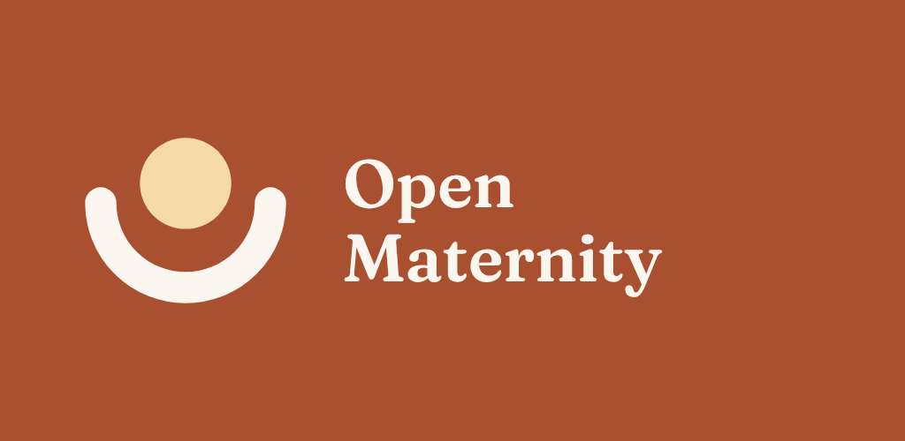
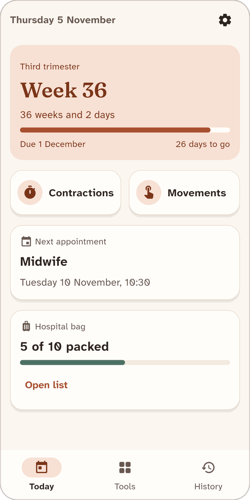
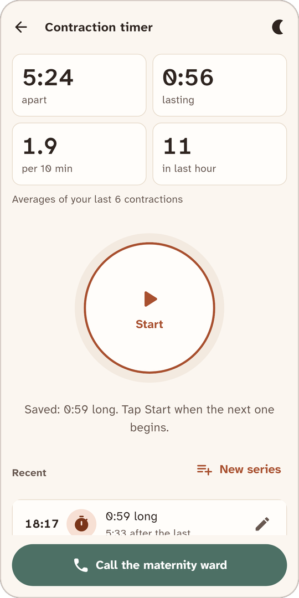
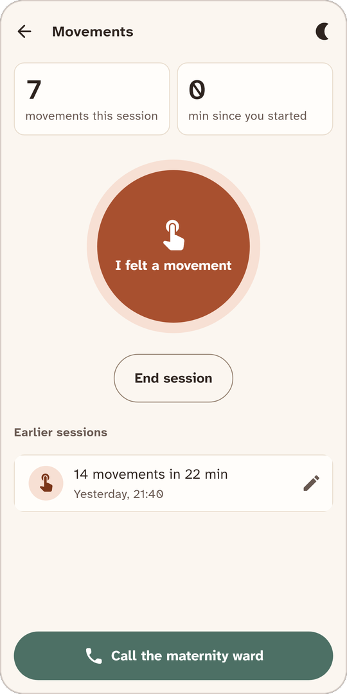
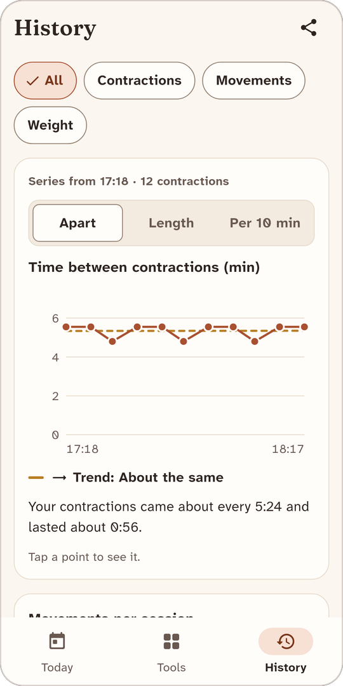
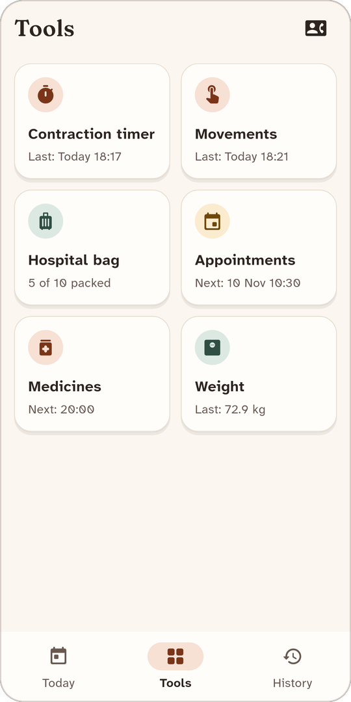
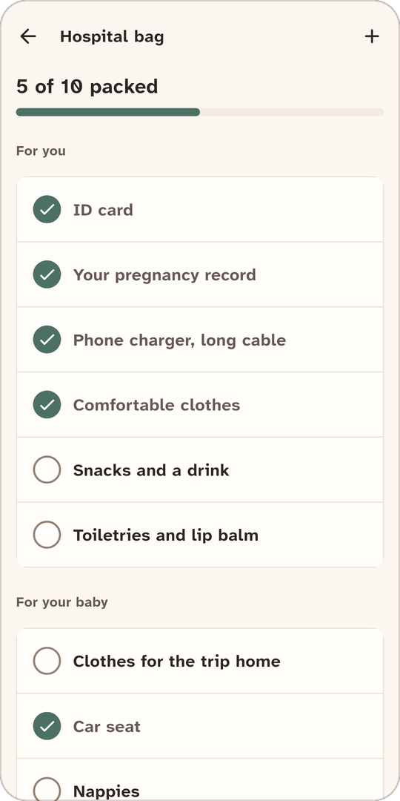
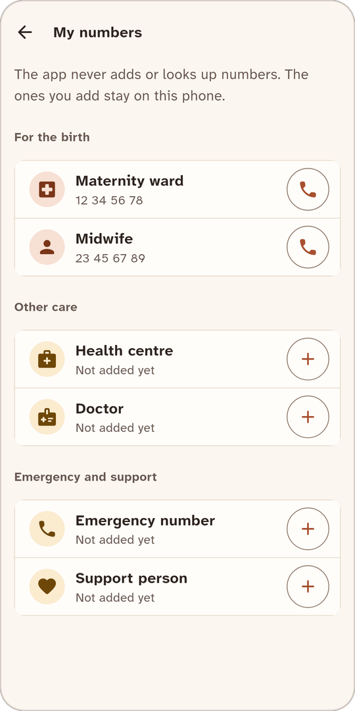
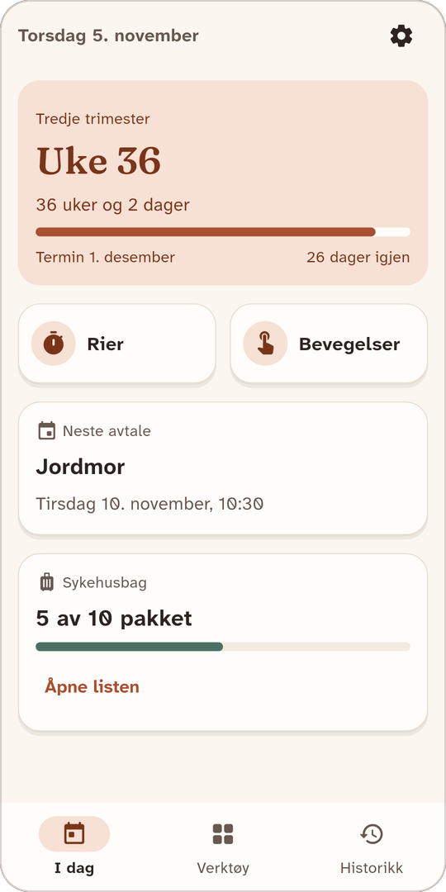

<h1 align="center">
  
</h1>

A free, calm toolkit for pregnancy: contraction timer, movement counter, hospital-bag checklist, appointments, medicine reminders and a weight log. In English, Norwegian (bokmål), Swedish and Danish.

- **Free and open source.** No ads, no in-app purchases, run as a non-profit (Apache-2.0).
- **Offline.** Every tool works without internet. Release builds for Android have no network permission at all.
- **Private.** No account, no analytics, no tracking. Everything stays on the phone. The user can export a backup file or a PDF summary and share it herself.
- **No built-in phone numbers.** The user adds the numbers she needs (maternity ward, midwife, …) and calls with one tap.
- **No medical advice.** The app shows what was logged. It does not tell anyone when to go to hospital; the "Call the maternity ward" button is always on the timer screens instead.

## Screenshots

<table>
  <tr>
    <td align="center"><br><sub>Today</sub></td>
    <td align="center"><br><sub>Contraction timer</sub></td>
    <td align="center"><br><sub>Movements</sub></td>
    <td align="center"><br><sub>History with trend chart</sub></td>
  </tr>
  <tr>
    <td align="center"><br><sub>Tools</sub></td>
    <td align="center"><br><sub>Hospital bag</sub></td>
    <td align="center"><br><sub>My numbers</sub></td>
    <td align="center"><br><sub>Norsk (bokmål)</sub></td>
  </tr>
</table>

The app also has a dark theme and a dimmed night theme for the timer screens. The images are made from the store screenshots in `docs/store-screenshots` (all four languages) with `tool/readme_images.py`.

## Try it

Every push to `main` builds an Android test APK. Download `open-maternity-test.apk` from the **test-build** release on the Releases page and open it on an Android phone. Test builds have an extra *For testing* section in Settings with sample data.

Store versions are released from tags such as `v1.0.0`; their Releases page entry has the signed `open-maternity.apk`.

## Build it yourself

You need Flutter 3.47.8 (stable).

```sh
flutter pub get
flutter test
flutter run                      # on a connected phone or emulator
flutter build apk --release      # Android
flutter build ios --release      # iOS (on a Mac)
```

## How it is organised

| Path | What |
| --- | --- |
| `lib/data/` | The data model, calculations (pregnancy week, contraction averages) and the store that saves to one JSON file |
| `lib/l10n/` | All text, one file per language. Keep every key and `{placeholder}` when translating |
| `lib/theme/` | Design tokens from the Open Maternity design system (colours checked for WCAG AA in light, dark and night) |
| `lib/ui/` | Screens, sheets and shared widgets |
| `lib/services/` | Reminders (local notifications), dialler, backup file, PDF summary |
| `tool/` | Platform setup, icons, store screenshots and release helpers |
| `docs/` | Privacy policy, store texts, the release checklist and the README images |

## Contributing translations

Text lives in `lib/l10n/strings_<lang>.dart`. The tests check that every language has every key and the same placeholders. The Norwegian, Swedish and Danish texts need a review by native speakers before the first store release.

## Releasing

Set the version in `pubspec.yaml` and `lib/version.dart`, then push a tag with the same version (`v1.0.0`). The **Release** workflow tests the app, builds signed store versions for Google Play and the App Store, and uploads them when the keys are set up. Run it by hand with *Dry run* ticked to check everything without keys. The one-time setup is in [docs/RELEASE.md](docs/RELEASE.md).
